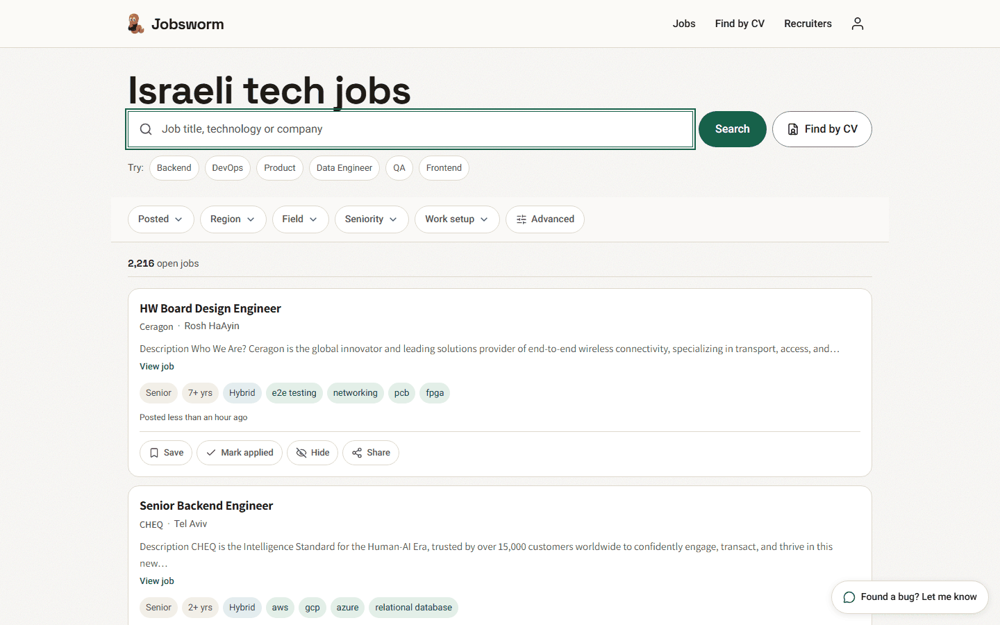
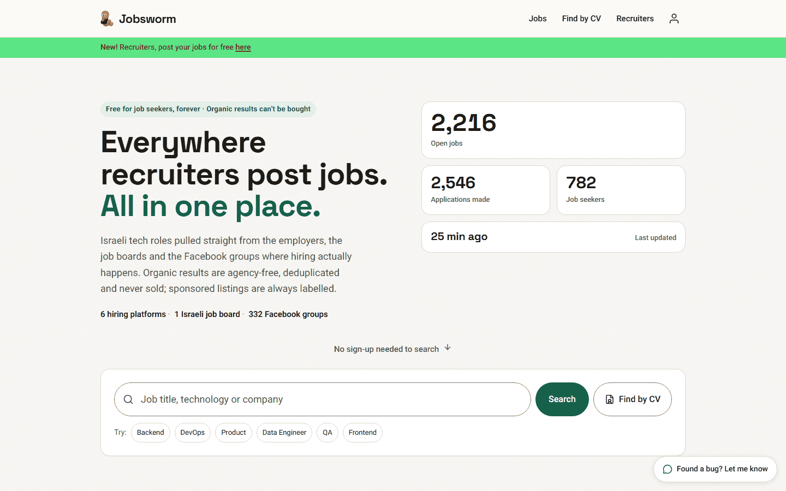
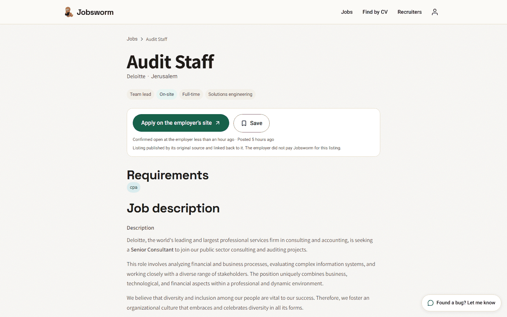
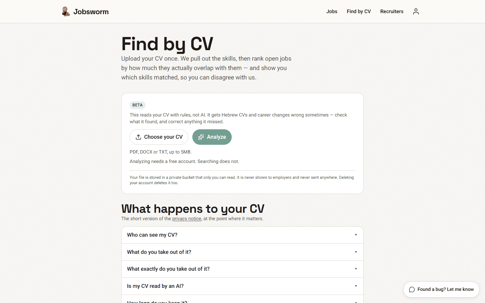
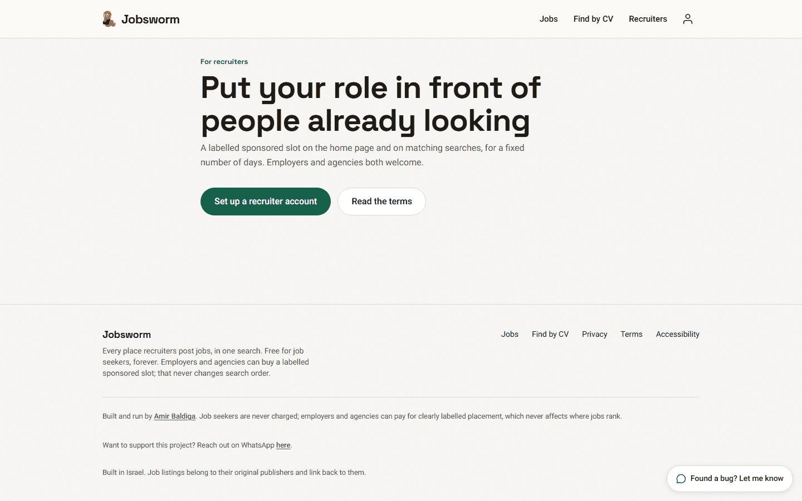
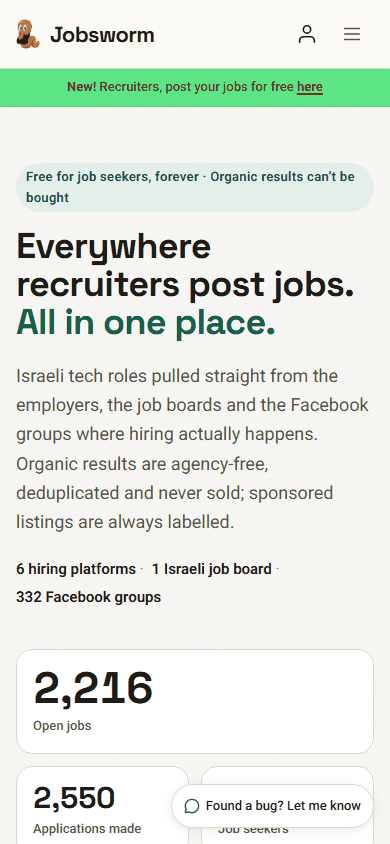
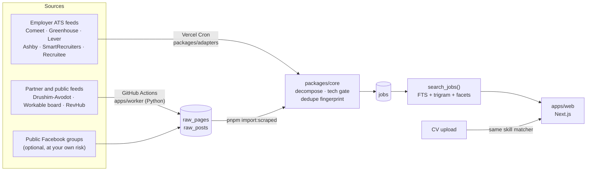

<p align="center">
  
</p>

<h1 align="center">Jobsworm</h1>

<p align="center">
  <strong>Every Israeli tech job, in one search.</strong><br>
  An open-source job aggregator: employer ATS feeds, partner feeds and public posts,
  decomposed by rules into structured, searchable data.
</p>

<p align="center">
  <a href="#what-it-looked-like">Screenshots</a> ·
  <a href="#build-your-own">Build your own</a> ·
  <a href="docs/architecture.md">Architecture</a> ·
  <a href="docs/lessons-learned.md">Lessons learned</a> ·
  <a href="CONTRIBUTING.md">Contributing</a>
</p>

---

Jobsworm pulls jobs straight from the places employers publish them — the public
job-board APIs behind their careers pages, a few partner feeds, and public hiring
posts — then turns every posting into the same structured record: function,
seniority, city, remote policy, skills, salary signals, agency or direct. Duplicates
are merged, dead listings are closed, non-tech roles are filtered out, and the result
is searchable in Hebrew and English.

It ran in production at jobsworm.fun from September to October 2026, peaking at
roughly 4,700 open jobs pulled from 289 employer boards, one Israeli partner feed and
332 public Facebook groups. **The site has now been retired and its database deleted.**
This repository is the whole system, published so you can read how it works, run it,
and build the same thing for your own market.

**What you can learn from it**

- **Aggregating without scraping where you don't have to.** Most of the index comes
  from employers' own ATS feeds (Comeet, Greenhouse, Lever, Ashby, SmartRecruiters,
  Recruitee), which exist to be read.
- **Rule-based NLP that holds up.** No LLM at runtime: a Hebrew-aware decomposer with
  dictionaries for skills, functions, locations and agencies, tested by 370+ unit tests.
- **Postgres as the search engine.** Full-text search, trigram matching, facets and
  ranking in SQL functions, behind row-level security.
- **Running on a shoestring.** A small Supabase instance, Vercel crons and GitHub
  Actions, paced so bulk writes never take search down.
- **The parts nobody writes about** — consent records, takedowns, terms of service,
  and the mistakes, in [docs/lessons-learned.md](docs/lessons-learned.md).

## What it looked like

The site is gone, so these are the only record of it. Captured on 26 October 2026,
the day it was retired.

**Search, which is the whole point.** Every posting is decomposed into the same
structured record, so seniority, years of experience, work setup and skills become
filters instead of free text you have to read.



**The home page.** 2,216 open jobs on the last day, down from a peak of about 4,700,
across 6 hiring platforms, one Israeli job board and 332 public Facebook groups.



**A single job.** Organic listings link back to whoever published them and say so on
the page: the employer did not pay to be there, and nothing about the ranking was for
sale.



**Find by CV.** Rules, not an LLM. It pulls skills out of a CV, ranks open jobs by how
much they genuinely overlap, and shows you which skills matched so you can disagree
with it.



**The paid side, and the phone.** A labelled sponsored slot for a fixed number of days
was the only thing money could buy, and it never changed organic ranking.

<p>
  
  
</p>

## How it works



1. **Collect.** `packages/adapters` leases companies that are due, calls their public
   ATS API, and upserts the postings. The Python worker in `apps/worker` handles the
   sources that are not ATS feeds and stores what it fetches in `raw_pages` / `raw_posts`.
2. **Decompose.** Every posting goes through `decompose()` in `packages/core`: pure
   functions, no I/O, each inferred field carrying a confidence. A tech-only gate drops
   roles that do not belong, and an agency classifier flags staffing-agency reposts.
3. **Maintain.** Jobs an employer stops listing are closed; scraped jobs expire;
   `linkcheck` closes listings whose page says the job is gone; nightly `pg_cron` jobs
   deduplicate and purge.
4. **Serve.** `apps/web` is a Next.js App Router site over Supabase. Search, facets and
   counts are SQL functions. Upload a CV and it is parsed by the same skill matcher
   that decomposes jobs, so both sides agree on what a skill is called.

More depth in [docs/architecture.md](docs/architecture.md).

## Repository layout

```
apps/web              Next.js 16 site: search, job pages, CV matching, recruiter area
apps/worker           Python scraper: partner feeds, Facebook groups, fetch ladder, link checker
packages/core         Decomposition rules, Hebrew normalisation, CV parser, dictionaries
packages/adapters     ATS adapters, the ingest loop, and the scraped-posting importer
supabase/migrations   Schema, RLS, search functions, cron jobs
scripts/seed          Company discovery, ATS detection, Facebook group discovery
scripts/              Audits, re-decomposition, brand assets, payment-product sync
data/                 Verified employer seed list and the skill-mining output
docs/                 Architecture, lessons learned, data sources and the law, brand
```

## Build your own

### Prerequisites

| Tool | Version | Why |
|---|---|---|
| Node.js | 24 | the web app and the TypeScript pipeline |
| pnpm | 10 | the monorepo (`corepack enable` gets you the pinned version) |
| Docker | any recent | the local Supabase stack |
| Supabase CLI | 2.x | installed as a dev dependency; run it with `pnpm exec supabase` |
| Python | 3.12 | only for the worker (`apps/worker`) and some seed scripts |

### 1. Install and start a local database

```bash
git clone https://github.com/baldiga/jobsworm.git
cd jobsworm
pnpm install
pnpm exec supabase start          # Postgres, Auth, Storage and Studio in Docker
pnpm exec supabase db reset       # applies all migrations to the empty database
```

### 2. Configure

```bash
cp .env.example .env.local
pnpm exec supabase status -o env  # prints API_URL, ANON_KEY, SERVICE_ROLE_KEY
```

Put those three into `.env.local` as `NEXT_PUBLIC_SUPABASE_URL`,
`NEXT_PUBLIC_SUPABASE_ANON_KEY` and `SUPABASE_SERVICE_ROLE_KEY`, set
`SEED_STAGGER_HOURS=0`, then give the web app the same file — Next.js reads env from
its own directory:

```bash
cp .env.local apps/web/.env.local
```

Everything else in `.env.example` is optional and documented in place.

### 3. Seed employers and fetch their jobs

```bash
pnpm seed                         # ~290 verified employers and their ATS boards
pnpm ingest:once --limit=40       # fetch, decompose and store their open jobs
```

`SEED_STAGGER_HOURS=0` makes every employer due at once. In production the default (48)
spreads the first fetch out so no ATS sees a burst. Run `ingest:once` again to work
through the rest; each pass takes the companies that are due.

### 4. Run the site

```bash
pnpm dev                          # http://localhost:3000
```

Search works without an account. To sign in locally, request a code and read it in the
local mail catcher at http://127.0.0.1:54324.

### 5. Optional: the Python worker

```bash
cd apps/worker
python -m venv .venv && . .venv/bin/activate   # Windows: .venv\Scripts\activate
pip install -r requirements.txt
cd ../..
pnpm scrape workable              # Workable's public board
pnpm scrape drushimavodot         # a documented partner feed
pnpm import:scraped --sources=workable,drushimavodot
```

`pnpm scrape --help` lists every command; each accepts `--dry-run`.

### Useful commands

| command | what it does |
|---|---|
| `pnpm test` | all unit tests (vitest) |
| `pnpm typecheck` | typecheck the packages the web build does not compile |
| `pnpm lint` | ESLint on the web app |
| `pnpm --filter web build` | production build of the site |
| `pnpm redecompose` | re-run the decomposer over stored jobs after changing a rule |
| `pnpm audit:index` | re-run every quality gate over the live index, report only |
| `pnpm detect:ats` | find which ATS a list of company domains uses |
| `pnpm post:job` | post an employer job by hand, through the same gate as the site |

## Deploying

The production setup is a hosted Supabase project, a Vercel project and GitHub Actions.

1. **Supabase.** Create a project, link it (`pnpm exec supabase link --project-ref <ref>`)
   and push the schema with `pnpm db:migrate`.
2. **Auth.** In the dashboard, not from the CLI — see the warning below:
   - set **Site URL** to your domain and add `https://your-domain/**` (and the `www.`
     variant) to **Redirect URLs**. An address missing from that list is silently
     replaced by the Site URL;
   - make the magic-link and signup email templates show `{{ .Token }}`, because the
     sign-in form asks for a 6-digit code (keep OTP length at 6);
   - configure custom SMTP before launch. The built-in sender is rate-limited to a
     handful of emails an hour, and blocked signups leave no trace in `auth.users`.
3. **Vercel.** Import the repo; `vercel.json` already sets the build. Add the variables
   from `.env.example`. The hourly crons in `vercel.json` need a paid plan: Hobby allows
   one run per cron per day and rejects the deploy otherwise.
4. **GitHub Actions.** The scheduled workflows in `.github/workflows` run the Python
   sources. Add `NEXT_PUBLIC_SUPABASE_URL`, `SUPABASE_SERVICE_ROLE_KEY`,
   `POSTER_HASH_SALT` and whichever source keys you use as repository secrets. Scheduled
   runs only fire for the original owner; edit the `if:` guard in each workflow for yours.

> **Never run `supabase config push` against a live project.** `config pull` cannot read
> the SMTP password, so a pull-then-push silently disables custom SMTP, resets Site URL
> to localhost and rewrites settings you did not touch. Change auth settings in the
> dashboard or with a targeted Management API `PATCH`.

**Make it yours.** The privacy policy, terms, accessibility statement and signup consent
text (`apps/web/lib/consent.ts`) describe the original operator. Rewrite them before you
launch; the consent text is versioned and hashed, so add a new `CONSENT_A_VERSION`
rather than editing the old one. The `NEXT_PUBLIC_OWNER_*` and `NEXT_PUBLIC_CONTACT_*`
variables control the footer credit and contact links.

## Adapting it to another country

The Israel-specific parts are data, and they are concentrated:

- `packages/core/src/data/locations.ts` — the city gazetteer and the "is this in the
  country" aliases;
- `packages/core/src/data/agencies.ts` — local staffing agencies;
- `packages/core/src/normalize.ts` and `synonyms.ts` — Hebrew normalisation and query
  synonyms;
- `data/companies.seed.json` — the employer list, rebuilt with `scripts/seed/`.

The ATS adapters, the ingest loop, the search functions and the web app are
country-neutral.

## Data sources and the law

Read this before you point the system at anything.

**What ships enabled.** Employer ATS feeds (published by employers so their jobs can be
read), the Drushim-Avodot partner feed (documented, attribution shown), Workable's public
job board (its robots.txt carries an explicit search-indexing grant), a curated
go-to-market feed, and two Facebook paths: a reader for publicly visible group posts and
an [Apify](https://apify.com) actor that does the same on Apify's infrastructure.

**What does not ship.** No scrapers for AllJobs, Drushim, Yad2, Secret Tel Aviv or
LinkedIn: their terms forbid republishing their listings. No logged-in Facebook reader:
reading as a user breaches Facebook's terms. The importer refuses those source names
outright. [docs/data-sources-and-legal.md](docs/data-sources-and-legal.md) explains
each decision.

> **Use at your own risk.** The Facebook sources, and any source you add, collect
> content published by other people on platforms with their own terms. Whether you may
> collect, store and republish it depends on where you are, what you do with it, the
> platform's terms of service, and data-protection law such as the GDPR or Israel's
> Privacy Protection Law. That determination is yours alone, and you are responsible
> for complying with it. Nothing in this repository is legal advice. The software is
> provided "as is", without warranty of any kind, as the [license](LICENSE) says; the
> authors accept no liability for how you use it. If in doubt, ask a lawyer before
> you run it.

Practical rules the code already follows, which you should keep if you extend it:

- read a site's **terms of use**, not only its `robots.txt` — the two often disagree,
  and only the terms decide whether you may republish;
- public content only, never anything behind a login;
- store a salted hash of a poster's identity, never their name or profile, and cap
  excerpts at 300 characters with a link back to the original;
- honour takedown requests quickly; the original site committed to 48 hours.

## Contributing

Contributions are welcome — bug reports, fixes, new ATS adapters, better Hebrew
handling, docs. Start with [CONTRIBUTING.md](CONTRIBUTING.md), and please read the
[Code of Conduct](CODE_OF_CONDUCT.md). Security issues go through
[SECURITY.md](SECURITY.md), not public issues.

**Status:** retired. The site was shut down in October 2026 and its database deleted,
so there is nothing running and nothing to break. The code is complete and still runs
from a clean checkout — see [Build your own](#build-your-own). The repository is
maintained on a best-effort basis; issues and pull requests are read, but responses
may take a while.

## License

The code is released under the [MIT License](LICENSE).

The Jobsworm name, the Wormy mascot and the logos in `apps/web/public/brand/` and
`docs/brand/` are **not** covered by the MIT License; all rights are reserved. See
[docs/brand/NOTICE.md](docs/brand/NOTICE.md). If you deploy your own copy, give it your
own name and artwork.

Built by [Amir Baldiga](https://www.linkedin.com/in/amirbaldiga).
