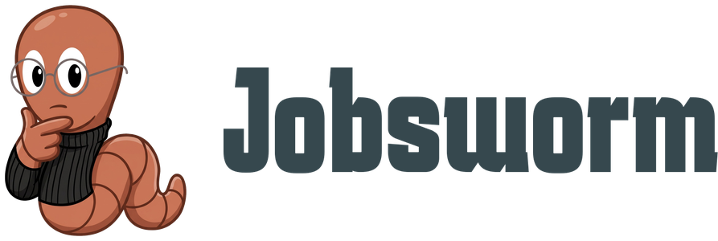

# Jobsworm Brand Guide

> The name, mascot and logos are not covered by the repository's MIT License. See
> [NOTICE.md](NOTICE.md).



## 1. Name and story

**Jobsworm** is a pun that carries the whole product. **Worm** — the mascot digs, tunnelling
through every job board, careers page, Telegram channel and startup ATS in Israel to surface the
listings nobody indexed properly. **Warm** — warm intros and referrals instead of cold
applications: the job you want is usually one person away, and we find that person too.

Taglines: **המשרה שמתחבאת ממך** / *Find the job hiding from you*. Secondary: **אנחנו חופרים. אתם מגישים.**

## 2. Wormy the mascot

Wormy (**וורמי**) is a cartoon detective worm in a deerstalker with a magnifying glass. Curious,
unhurried, slightly deadpan — a competent investigator, never a hype man. He does the boring
digging so the user doesn't have to.

**Allowed:** empty states, loading states, error and 404 copy, onboarding, marketing pages.
**Never:** job cards, search results, salary data, employer profiles, email subject lines, legal
and privacy text. Anywhere the user is deciding about their career, the interface is plain and
the mascot stays out of it.

## 3. Logo system

Three lockups, all built from the same cut-out mascot:

| Lockup | Asset | Use |
| --- | --- | --- |
| Mascot only | `mascot-*.png` | Favicons, app icons, avatars, loading states |
| Wordmark only | `wordmark.svg` | Tight headers, footers, partner walls |
| Full lockup | `lockup-light.png` / `lockup-dark.png` | Nav bar, marketing, email header, README |

- **Clear space:** on every side, at least the cap height of the `J` in the wordmark.
- **Minimum sizes:** mascot 24px tall; full lockup 120px wide. Below that, use the mascot alone.
- **Allowed backgrounds:** white `#FFFFFF` and the newsprint ground `#FBFAF7`. Never on copper,
  on a photo, or on any mid-tone that kills the outline. The ground is warm and near-white, so
  check the cut-out for a cool-white fringe before placing the mascot at size on it; inside a
  ruled box on `surface` white is the safe placement and is a legitimate newspaper treatment.
- **RTL:** the lockup is **always mascot-left**, including on Hebrew pages. It is a picture, not
  a sentence — it does not mirror.

**Don'ts:** no recoloring, stretching, squashing or rotation; no drop shadow or glow; no cropping
the magnifying glass; no sticker border; never stack the wordmark above the mascot.

## 4. Color

`wordmark.svg` ships as `fill="currentColor"`, so it inherits whichever token you set.

The palette is **newsprint**: a warm near-white ground, ink, and one copper accent. It is
**light only** — there is no dark theme, deliberately. A printed classifieds sheet has no dark
mode, and a half-maintained second palette was worse than none.

| Token | Value | Role |
| --- | --- | --- |
| `bg` | `#FBFAF7` | The paper. Page ground, never a card |
| `surface` | `#FFFFFF` | The pasted slip: cards, inputs, menus |
| `surface-2` | `#F2EFE8` | Quiet fills, zebra rows, disabled |
| `fg` | `#1F1B16` | All primary text and all heavy rules |
| `fg-2` | `#57514A` | Metadata, captions, folio. **The only grey.** |
| `primary` | `#1F1B16` | Wordmark |
| `action` | `#C2521F` | Copper. Button fills, marks, rules |
| `action-text` | `#A8441A` | Copper-coloured **text**. See rule 1 below |
| `action-hover` | `#9E3F14` | Hover and active |
| `on-action` | `#FFFFFF` | Text on a copper fill |
| `accent-tint` | `#F7E9DF` | Copper wash: highlighted rows, tags |
| `accent-text` | `#A8441A` | Text on `accent-tint` |
| `info-tint` | `#E4EDF0` | Lens blue: info banners, tips |
| `info-text` | `#2C4A54` | Text on `info-tint` |
| `warn-tint` | `#F5EAC9` | Warning background |
| `warn-text` | `#5A4310` | Text on `warn-tint` |
| `line` | `#DED8CC` | Default hairline |
| `line-strong` | `#8A8175` | Input borders, leader dots |
| `ok` | `#146043` | Verified, applied, saved |
| `bad` | `#A32617` | Errors, destructive actions |

**Contrast rules (computed, not estimated):**

1. **`action` `#C2521F` on `bg` is 4.45:1 and FAILS AA for text under 24px.** It misses by 0.05.
   It passes AA-Large, and white on it passes at 4.65:1. So copper is a **fill** colour, and
   every copper-coloured text run under 24px uses `action-text` `#A8441A` (**5.74:1**) instead.
   This is the single easiest rule in the system to break by accident.
2. `fg` on `bg` is **16.40:1**, `fg-2` on `bg` is **7.28:1**. Both AAA.
3. `ok` and `bad` sit at **7.23:1** and **7.07:1** — AAA on purpose. On a near-monochrome page a
   colour that appears three times a session has to be unmistakable.
4. **Never put white text on brass `#B49048`** — **2.99:1**, fails at every size. Brass is a
   decorative stroke (the magnifier rim), not a surface.

## 5. Typography

Two families, both **variable**, and — this is the point — **both carry Hebrew and Latin**.

| Role | Font | Size / line-height |
| --- | --- | --- |
| Wordmark, h1–h2 | **Frank Ruhl Libre** 700–900 | h1 clamp(32→44), h2 clamp(24→32), lh **1.18 / 1.22** |
| h3, card and step titles | **Assistant** 600 | 19, line-height **1.47** |
| Body | **Assistant** 400 | **17**, line-height **1.65** |
| Small, caption, folio | **Assistant** 400/500 | 15 / 12.5 |
| Numerals | **Frank Ruhl Libre**, `tabular-nums lining-nums` | per context |

```css
--font-display: var(--font-frank), Georgia, "Times New Roman", serif;
--font-body: var(--font-assistant), ui-sans-serif, system-ui, sans-serif;
```

**Why this replaced Karantina + Poppins + Varela Round.** The previous stack was a deliberate
split — Poppins for Latin, Varela Round for Hebrew, relying on per-character fallthrough — and it
was documented here as intentional. It resolved correctly in the sense that no glyph was missing,
but the result was that a single string like `מפתח Full Stack` was **set in two different
typefaces at two different optical sizes**. Falling through per character is a way to avoid
missing glyphs; it is not a way to set type. Two families that each cover both scripts remove the
problem at the source, and drop one font request while doing it.

**Hebrew type rules — these are not stylistic preferences**

- **Body is 17px, not 16.** Hebrew has no ascenders or descenders to speak of and reads optically
  smaller than Latin at the same pixel size.
- **Body line-height 1.65, headings 1.18–1.22.** A Hebrew line is a near-solid dark band with no
  descenders to mark where it ended, so the eye needs more help on the return sweep than Latin's
  conventional 1.5 gives. Headings go the other way but not as far as Latin display: the old
  **1.05 was a Latin habit** and collides the moment a Hebrew headline wraps, because Frank Ruhl
  Libre's `ל` rises and its final letters descend.
- **Letter-spacing is 0.** With no capitals and no ascender profile, widening the letter gap pushes
  it toward the word gap and the line fuses into one undifferentiated bar. Tracking is allowed only
  on Latin-only runs, inside a `.latin` isolate so it cannot leak.
- **Never italic.** Hebrew has no true italic; the browser synthesises a slant that looks broken.
  Emphasis is weight or colour.
- **Never `text-transform: uppercase`.** Hebrew has no case, so it is a silent no-op on the Hebrew
  and quietly mangles any Latin token caught inside.
- Numerals are Latin digits, so every number is a script switch. Set them deliberately: display
  face, tabular figures.

**RTL notes**

- Set `dir="rtl"` on `<html>` for the Hebrew locale, not on individual components.
- Use CSS logical properties everywhere: `margin-inline-start`, `padding-inline`, `inset-inline-end`,
  `border-start-start-radius`. No `left` / `right` in component CSS.
- Wrap every Latin token in prose in `<bdi>`, and salary strings in `<bdi dir="ltr">` — `₪` is bidi
  class ET and an en-dash is neutral, so `₪28–35K` puts the currency symbol on the wrong end
  without isolation.
- Directional icons (arrows, chevrons) carry `rtl:-scale-x-100`. Non-directional ones
  (bookmark, check, close) must **not** mirror. A breadcrumb separator points along the reading
  direction, which in RTL is leftward.
- Horizontal overflow in RTL escapes to the **left**. A check that only looks at the right edge
  will miss it.

Radii: **2px** chips and tags, **3px** controls, **4px** cards and sheets. There is deliberately
no pill token — `border-radius: 9999px` is the loudest generic tell available, and the same chip
at 2px reads as a printed tag. There are **no box-shadows** anywhere in the system; a card is a
hairline rule.

## 6. Voice

Direct second person. No recruiter-speak — no "opportunity", "exciting role", "rockstar". No
exclamation marks, anywhere. Tech terms stay in English inside Hebrew sentences (Backend,
Series B, on-site). Numbers are digits. Gender-neutral Hebrew where the language allows it;
where it does not, prefer plural or infinitive phrasing over `/ה`. Detective vocabulary in small
doses — and **never in error messages**, where the user is stuck and a joke reads as a shrug.

| Context | Hebrew | English |
| --- | --- | --- |
| Hero | המשרה שמתחבאת ממך. אנחנו סורקים 40 מקורות ומוצאים גם את מה שלא פורסם בלינקדאין. | The job hiding from you. We scan 40 sources, including the ones that never reach LinkedIn. |
| Empty result | לא מצאנו כלום ל-Rust בחיפה. תרחיבו לגוש דן או הורידו את שנות הניסיון. | Nothing for Rust in Haifa. Widen to Tel Aviv area, or drop the years-of-experience filter. |
| Error | לא הצלחנו לטעון את המשרות. נסו שוב בעוד רגע. | We couldn't load the jobs. Try again in a moment. |
| Salary | מפורסם 28–35K · טווח שוק 27–36K | Posted 28–35K · Market range 27–36K |
| Verified badge | מעסיק מאומת · נבדק ב-3 בספטמבר | Verified employer · Checked 3 September |

## 7. Asset index

All under `apps/web/public/brand/`, generated by `python scripts/brand/build_all.py`.

| File | Size | Use |
| --- | --- | --- |
| `mascot-1024.png` … `mascot-32.png` | 912×1024 → 28×32 | Transparent Wormy at six sizes |
| `favicon.ico` | 16/32/48 | Browser tab (also copied to `apps/web/app/favicon.ico`) |
| `icon-192.png` | 192×192 | PWA manifest icon |
| `icon-512.png` | 512×512 | PWA manifest icon, install prompt |
| `icon-maskable-512.png` | 512×512 | Android maskable icon (60% safe zone) |
| `apple-touch-icon.png` | 180×180 | iOS home screen |
| `wordmark.svg` | 3242×708 vb | Outlined wordmark, `currentColor`, no embedded font |
| `wordmark-light.png` / `-dark.png` | 975×213 | Raster wordmark in `#36484E` / `#F6F8F9` |
| `lockup-light.png` / `-dark.png` | 911×300 | Full lockup for light / dark backgrounds |

Scripts: `remove_bg.py` (border-seeded flood fill — preserves the lens and eye whites),
`make_icons.py`, `make_wordmark.py`, `build_all.py` (runs all three, asserts, prints a report).

## 8. Later

- **Vector redraw.** Wormy is a raster cut-out today; a designer should redraw him as clean
  vectors so he stays sharp at 16px and can be recolored per theme.
- **Self-hosted fonts.** Subset all three families (`woff2`, Hebrew + Latin) and self-host, to
  drop the Google Fonts round-trip and the layout shift with it.
- **Motion.** A digging loop for loading and a magnifier sweep for search — under 1.5s, both
  respecting `prefers-reduced-motion`.
- **Illustration set.** Empty, no-results, error, warm-intro — same line weight and espresso
  outline as the mascot, so they read as one family.
